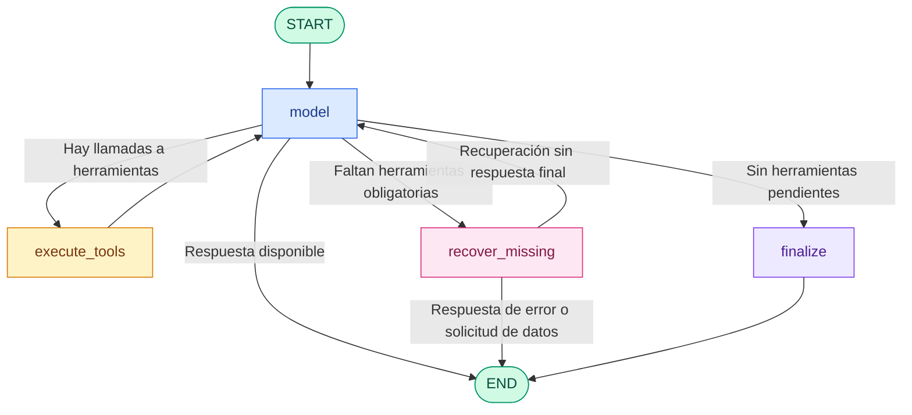

# Enterprise Business Intelligence Research Agent

Agente inteligente especializado en el análisis automatizado de datos empresariales de ventas e inventario. Está desarrollado con Python 3.12+, LangGraph, Ollama y SQLite, y utiliza `uv` para la gestión del entorno y las dependencias.

El proyecto prioriza la robustez, la validación determinista de datos y la ejecución local mediante modelos de lenguaje. Su objetivo es generar respuestas fundamentadas en datos verificables, reduciendo el riesgo de alucinaciones y evitando afirmaciones sin evidencia.

## Descripción general

El agente está diseñado para responder preguntas sobre ventas e inventario a partir de datos locales y verificables. Su flujo de trabajo separa la interpretación del problema por parte del modelo de lenguaje de la ejecución de herramientas y la validación determinista de resultados.

Esto permite:

- Consultar ventas por producto y periodo.
- Revisar el estado del inventario.
- Validar resultados antes de construir una respuesta final.
- Detectar preguntas sin evidencia suficiente y responder con prudencia.
- Mantener la ejecución en entorno local con SQLite y Ollama.

## Arquitectura del sistema

El agente utiliza LangGraph para gestionar un flujo de ejecución basado en estados. La arquitectura separa la interpretación flexible del modelo de lenguaje de la ejecución de herramientas y la validación de los resultados.

### Diagrama de flujo



### Componentes principales

- `model`: nodo que consulta al modelo de lenguaje, interpreta la pregunta y determina si necesita ejecutar herramientas.
- `execute_tools`: ejecuta las herramientas solicitadas, valida sus argumentos, controla los errores y registra los resultados.
- `recover_missing`: identifica herramientas obligatorias que el modelo no ha solicitado e intenta recuperarlas cuando dispone de la información necesaria.
- `finalize`: prepara la respuesta final cuando no quedan herramientas obligatorias pendientes.
- `build_verified_answer()`: construye respuestas basadas en resultados validados de ventas e inventario, sin inventar cifras ni atribuir causas que no puedan demostrarse.
- `END`: representa la finalización del flujo de ejecución.

El grafo también contempla límites de iteración y rutas de salida para evitar ejecuciones indefinidas.

## Características principales

- Respuestas fundamentadas en datos: las cifras de ventas e inventario proceden de las herramientas de consulta y se validan antes de elaborar la respuesta final.
- Control de afirmaciones sin evidencia: el agente evita atribuir variaciones de ventas a competidores u otras causas que no pueden demostrarse con los datos disponibles.
- Validación estricta: comprueba tipos de datos, valores numéricos, campos obligatorios y coherencia de los resultados.
- Ejecución segura de herramientas: gestiona nombres de herramientas desconocidos, argumentos malformados y errores internos.
- Recuperación de herramientas omitidas: intenta ejecutar consultas obligatorias que el modelo haya dejado pendientes.
- Persistencia local: utiliza SQLite para almacenar y consultar los datos empresariales.
- Modelo de lenguaje local: utiliza Ollama para ejecutar modelos en el entorno local.
- Pruebas automatizadas: incorpora pruebas para casos normales, entradas inválidas y situaciones límite.

La arquitectura está diseñada para reducir alucinaciones mediante validación y generación determinista de respuestas. Esto no implica que todas las respuestas del modelo estén libres de error, pero sí que el sistema intente fundamentarlas en evidencia verificable.

## Tecnologías utilizadas

| Tecnología | Propósito |
| --- | --- |
| Python 3.12+ | Lenguaje principal |
| LangGraph | Orquestación del flujo del agente |
| Ollama | Ejecución local del modelo de lenguaje |
| SQLite | Almacenamiento y consulta de datos |
| uv | Gestión del entorno y dependencias |
| pytest | Pruebas automatizadas |
| pytest-cov | Medición de cobertura del código |

## Requisitos previos

Antes de instalar el proyecto, asegúrate de tener:

- Python 3.12 o superior.
- `uv` instalado.
- Ollama instalado y disponible localmente.
- Git para clonar el repositorio.

## Instalación y configuración

### 1. Clonar el repositorio

```bash
git clone https://github.com/tu-usuario/research-agent.git
cd research-agent
```

### 2. Instalar las dependencias

```bash
uv sync
```

Este comando instala las dependencias declaradas en el proyecto y prepara el entorno gestionado por `uv`.

### 3. Descargar el modelo de Ollama

```bash
ollama pull qwen2.5:3b-instruct
```

Asegúrate de que el nombre del modelo coincida con la configuración utilizada en el código.

### 4. Inicializar la base de datos

Si el proyecto incluye el script `setup_db.py`, ejecuta:

```bash
uv run python setup_db.py
```

Este script inicializa la base de datos SQLite y carga los datos sintéticos e históricos definidos por el proyecto.

## Uso

### Consultar ventas e inventario

Para solicitar un análisis de ventas y consultar el inventario de un producto:

```bash
uv run python cli.py ask "Analiza las ventas de PROD-001 de los dos últimos meses y consulta su inventario."
```

### Evaluar una hipótesis sin evidencia suficiente

Para comprobar cómo responde el agente ante una pregunta que atribuye variaciones a una causa no demostrada:

```bash
uv run python cli.py ask "¿La caída de ventas de PROD-001 fue causada por un competidor?"
```

El agente debe distinguir entre los datos comprobados y las causas que no pueden determinarse con la información disponible.

### Consultar directamente las herramientas

Resumen de ventas de los dos últimos meses:

```bash
uv run python cli.py sales --product PROD-001 --months 2
```

Estado del inventario de un producto:

```bash
uv run python cli.py inventory --product PROD-002
```

### Ayuda de la CLI

```bash
uv run python cli.py --help
```

## Pruebas y evaluación

### Ejecutar las pruebas automatizadas

Para ejecutar toda la suite:

```bash
uv run pytest -v
```

### Medir la cobertura

Para medir la cobertura de `agent.py` y `database.py`:

```bash
uv run pytest --cov=database --cov=agent --cov-report=term-missing
```

La opción `term-missing` permite identificar las líneas que todavía no están cubiertas por las pruebas.

### Estado de las pruebas

En la última ejecución compartida durante el desarrollo se obtuvieron estos resultados:

- 86 de 86 pruebas superadas.
- 99 % de cobertura global.
- `agent.py`: 99 % de cobertura.
- `database.py`: 100 % de cobertura.

Estos resultados corresponden a la última ejecución registrada y pueden variar si se modifica el código.

### Ejecutar la evaluación de comportamiento

Si `evaluate_agent.py` está disponible en el repositorio, ejecuta:

```bash
uv run python evaluate_agent.py
```

Esta evaluación está destinada a comprobar el comportamiento del agente ante escenarios definidos y casos límite.

## Estructura del proyecto

```text
research-agent/
├── agent.py
├── database.py
├── cli.py
├── setup_db.py
├── evaluate_agent.py
├── evaluation_cases.json
├── tests/
│   ├── test_agent.py
│   └── test_database.py
├── pyproject.toml
├── uv.lock
├── README.md
├── research.db
└── .gitignore
```

### Descripción de los componentes principales

- `agent.py`: define el estado, los nodos, el grafo de LangGraph, los validadores y la lógica de ejecución del agente.
- `database.py`: contiene las consultas y herramientas para recuperar información de ventas e inventario.
- `cli.py`: proporciona la interfaz de línea de comandos.
- `setup_db.py`: inicializa la base de datos y carga los datos de prueba.
- `evaluate_agent.py`: ejecuta evaluaciones automatizadas del comportamiento del agente.
- `evaluation_cases.json`: contiene los casos de evaluación y sus condiciones esperadas.
- `tests/`: agrupa las pruebas automatizadas.
- `pyproject.toml`: declara las dependencias y la configuración del proyecto.
- `uv.lock`: registra las versiones resueltas de las dependencias.
- `research.db`: base de datos SQLite local, que no debe versionarse si se ha decidido excluirla del repositorio.

## Principios de diseño

### Separación de responsabilidades

El modelo de lenguaje interpreta las preguntas y decide qué herramientas necesita. La capa de herramientas recupera los datos y la lógica determinista valida los resultados y construye la respuesta final.

### Datos como fuente de verdad

SQLite es la fuente de datos empresariales de la aplicación. El agente no debe sustituir resultados reales por cifras generadas por el modelo.

### Validación antes de generar respuestas

Los argumentos y resultados de las herramientas deben cumplir condiciones de validación antes de utilizarse en la respuesta final.

### Manejo controlado de errores

Los errores deben tratarse de manera explícita, evitando que las excepciones internas o los resultados inválidos se conviertan en afirmaciones empresariales.

### Desarrollo incremental y verificable

Los cambios se validan mediante pruebas automatizadas para mantener la estabilidad y reducir regresiones.

## Privacidad y ejecución local

El proyecto está diseñado para utilizar Ollama y SQLite localmente. Esta arquitectura permite mantener el procesamiento dentro del entorno propio cuando todos los componentes se ejecutan de forma local.

La ejecución completamente offline depende de que el modelo esté descargado previamente, de que las dependencias estén instaladas y de que la configuración no introduzca llamadas externas.

## Estado del proyecto

El proyecto dispone de herramientas de consulta de ventas e inventario, validación de datos, orquestación con LangGraph y una suite de pruebas automatizadas.

La siguiente etapa de desarrollo puede centrarse en verificar el flujo completo con Ollama, reforzar las pruebas de integración y documentar los resultados obtenidos en ejecuciones reales.
