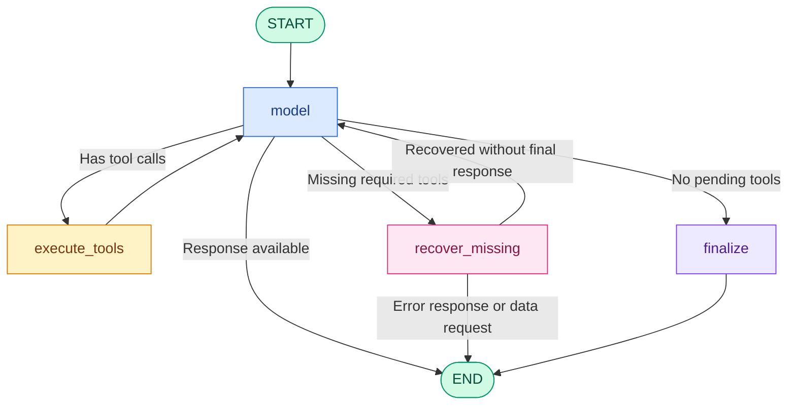

# Enterprise Business Intelligence Research Agent
<!--
[](https://github.com/Isomorfismo/research-agent/actions)
[](https://codecov.io/gh/Isomorfismo/research-agent)
[](LICENSE)
-->
Agente inteligente especializado en el análisis automatizado de datos empresariales de ventas e inventario. Está desarrollado con Python 3.12+, LangGraph, Ollama y SQLite, y utiliza `uv` para la gestión del entorno y las dependencias.

El proyecto prioriza la robustez, la validación determinista de datos y la ejecución local mediante modelos de lenguaje. Su objetivo es generar respuestas fundamentadas en datos verificables, reduciendo el riesgo de alucinaciones y evitando afirmaciones sin evidencia.

---

## English — Enterprise Business Intelligence Research Agent

An intelligent agent specialized in automated analysis of business sales and inventory data. Built with Python 3.12+, LangGraph, Ollama and SQLite, and using `uv` for environment and dependency management.

The project emphasizes robustness, deterministic data validation and local execution using language models. Its goal is to produce answers grounded in verifiable data and to minimize hallucinations.

## Overview

The agent answers questions about sales and inventory based on local, verifiable data. Its workflow separates the model's interpretation of a question from tool execution and deterministic validation of results.

Capabilities:

- Query sales by product and period.
- Check inventory status.
- Validate results before producing a final answer.
- Detect questions lacking sufficient evidence and respond cautiously.
- Run locally using SQLite and Ollama.

## Architecture

The agent uses LangGraph to manage a state-based execution flow. The architecture separates the flexible interpretation by the language model from the execution of tools and validation of results.

### Flow diagram



### Main components

- `model`: node that queries the language model, interprets the question and decides whether to execute tools.
- `execute_tools`: runs requested tools, validates arguments, handles errors and records results.
- `recover_missing`: identifies mandatory tools the model didn't request and tries to recover them when enough information is available.
- `finalize`: prepares the final answer when no mandatory tools are pending.
- `build_verified_answer()`: builds answers from validated sales and inventory results, avoiding invented figures or unproven causal attributions.

The graph includes iteration limits and exit routes to avoid infinite loops.

## Key features

- Data-grounded answers: sales and inventory figures come from query tools and are validated before being used in the final answer.
- Evidence-aware responses: the agent avoids attributing changes to competitors or causes not supported by data.
- Strict validation: checks types, numeric ranges, required fields and result consistency.
- Safe tool execution: handles unknown tool names, malformed arguments and internal errors.
- Recovery of omitted tools: attempts to run mandatory queries the model omitted.
- Local persistence: uses SQLite as the source of truth.
- Local language model: uses Ollama for local model execution.
- Automated tests: includes unit tests and edge-case checks.

## Technologies

| Technology | Purpose |
| --- | --- |
| Python 3.12+ | Primary language |
| LangGraph | Agent flow orchestration |
| Ollama | Local LLM execution |
| SQLite | Data storage and queries |
| uv | Environment & dependency management |
| pytest | Automated testing |
| pytest-cov | Coverage measurement |

## Prerequisites

- Python 3.12 or newer
- `uv` installed
- Ollama installed and available locally
- Git

## Installation

### 1. Clone the repository

```bash
git clone https://github.com/Isomorfismo/research-agent.git
cd research-agent
```

### 2. Install dependencies

```bash
uv sync
```

### 3. Download the Ollama model

```bash
ollama pull qwen2.5:3b-instruct
```

Confirm the model name matches the configuration used by the code. If your setup uses a different model, replace the name above accordingly.

### 4. Initialize the database

If `setup_db.py` is present, run:

```bash
uv run python setup_db.py
```

This script initializes the local SQLite database and loads synthetic/historical data used for tests and examples.

## How to run (examples)

### Ask the agent

```bash
uv run python cli.py ask "Analyze sales for PROD-001 in the last 2 months and check its inventory."
```

### Direct tool queries

Sales summary for the last 2 months:

```bash
uv run python cli.py sales --product PROD-001 --months 2
```

Inventory status for a product:

```bash
uv run python cli.py inventory --product PROD-002
```

### CLI help

```bash
uv run python cli.py --help
```

## Running locally (virtual environment example)

1. Create and activate a virtual environment:

```bash
python -m venv .venv
source .venv/bin/activate  # on Windows: .venv\Scripts\activate
```

2. Install `uv` (if not installed globally) and sync project dependencies:

```bash
python -m pip install --upgrade pip
pip install uv
uv sync
```

3. Initialize DB and pull the model (see steps above), then run the CLI.

## Tests & coverage

Run tests:

```bash
uv run pytest -v
```

Measure coverage for `agent.py` and `database.py`:

```bash
uv run pytest --cov=database --cov=agent --cov-report=term-missing
```

## Project structure

```text
research-agent/
├── agent.py
├── database.py
├── cli.py
├── setup_db.py
├── evaluate_agent.py
├── evaluation_cases.json
├── tests/
│   ├── test_agent.py
│   └── test_database.py
├── pyproject.toml
├── uv.lock
├── README.md
├── research.db
└── .gitignore
```

## Contributing

Contributions are welcome. To contribute:

1. Fork the repository.
2. Create a feature branch (`git checkout -b feature/my-change`).
3. Run tests locally and ensure they pass.
4. Open a pull request describing your changes.

Please avoid committing local artifacts such as `research.db` or virtual environment folders.

## .gitignore recommendation

Ensure `research.db` and typical Python artifacts are ignored. A sample `.gitignore` is included in the repository.

## License

This project is provided under the MIT License (if you choose a different license, update the badge and LICENSE file accordingly).

## Privacy & local execution

The project is designed to run locally with Ollama and SQLite so data and model execution can remain in your environment. Fully offline operation requires the model to be downloaded locally and no external network calls in configuration.

## Status

The project includes tools to query sales and inventory, deterministic validation logic, LangGraph orchestration and automated tests. Next steps may include full integration verification with Ollama, expanded integration tests and publishing example evaluation results.
